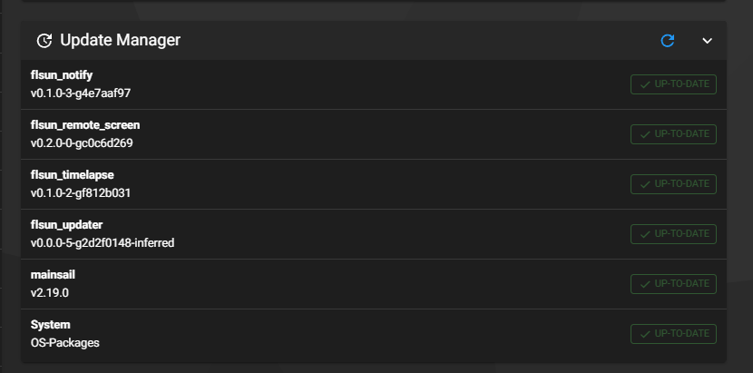

# FLSUN_Updater

Installs, updates and removes plugins for the **FLSun T1 Pro** from Mainsail, Fluidd or a macro, and fixes the parts of FLSun's system image that stop updates from working.

## What it fixes

FLSun's system image can't reach GitHub as shipped, and its update manager can't update Mainsail. FLSUN_Updater fixes this at install and again at every boot:

- **Clock.** The printer starts with a stale date on every boot and never syncs, so every HTTPS connection fails. A boot service sets the clock.
- **Certificates.** The `/etc/ssl/certs` links are missing, so curl rejects every certificate. They're rebuilt.
- **git.** git's https support was deleted. It's reinstalled.
- **Mainsail updates.** FLSun ships `~/mainsail` owned by root, but Moonraker runs as `pi`, so updating Mainsail fails with `Permission denied`. The folder is given to `pi`.
- **Stuck update checks.** If the update manager last checked while the clock was wrong, its certificate checks failed and its next automatic check can be years away. Those checks are run again.
- **Release updates (`type: web`).** FLSun's older Moonraker downloads the wrong file from a release, loses files listed in `persistent_files` that sit in subfolders, drops the executable bits, and can't update folders owned by root. FLSUN_Updater's Moonraker component handles these entries instead.
- **`sudo: unable to resolve host`.** The printer's hostname is added to `/etc/hosts`.

## Plugins

The plugin list is [extra_plugins.moonraker.conf](extra_plugins.moonraker.conf): Moonraker `[update_manager]` entries in the same format as Zmod's. Most are `git_repo` pointers to a plugin's repo, and `type: web` entries install another project's GitHub releases directly.

| Plugin | What it does |
| --- | --- |
| `flsun_timelapse` | [FLSUN_Timelapse](https://github.com/DIEHARDave/FLSUN_Timelapse): timelapse videos in Mainsail with no need for FLSun phone app to retrive videos. |
| `flsun_remote_screen` | [FLSUN_RemoteScreen](https://github.com/DIEHARDave/FLSUN_RemoteScreen): view and control the touchscreen from a browser |
| `flsun_notify` | [FLSUN_notify](https://github.com/DIEHARDave/FLSUN_notify): print notifications with a camera photo to Telegram, Discord, Matrix and [many more services](https://github.com/caronc/apprise/wiki) |
| `flsun_macros` | [FLSUN_Macros](https://github.com/DIEHARDave/FLSUN_Macros): Klipper macros the T1 Pro is missing, starting with pause at layer (`SET_PAUSE_AT_LAYER`) |
| `flsun_theme` | [FLSUN_theme](https://github.com/DIEHARDave/FLSUN_theme): FLSun's theme (logo and backgrounds) for Mainsail, and as the FLSUN theme in Fluidd; your previous theme folders are backed up and put back when you disable it |
| `fluidd` | [Fluidd](https://github.com/fluidd-core/fluidd) at `http://<printer-ip>:81`, beside Mainsail on port 80, from Fluidd's own releases. Both show the same cameras, and FLSUN_RemoteScreen's `/screen/` works in both. |
| `helixscreen` | [HelixScreen](https://github.com/prestonbrown/helixscreen) in place of FLSun's stock screen, from HelixScreen's own releases. **Coming soon:** listed once HelixScreen's main branch supports the T1 Pro. |

To ask for another plugin, [open a plugin request](https://github.com/DIEHARDave/FLSUN_Updater/issues/new?template=plugin_request.yml). Plugin authors: see [docs/adding-plugins.md](docs/adding-plugins.md).

## Install

SSH into the printer as `pi` (the default password is `1`), then:

```sh
sudo ntpdate -u -b time.google.com
curl -fsSL --cacert /etc/ssl/certs/ca-certificates.crt https://raw.githubusercontent.com/DIEHARDave/FLSUN_Updater/main/prepare.sh | bash
cd ~
git clone https://github.com/DIEHARDave/FLSUN_Updater.git
~/FLSUN_Updater/install.sh
```

The first two commands set the clock and repair certificates and git so that `git clone` works. Don't use `timedatectl set-ntp true`: on this image it stops the time service rather than starting it.

The installer restarts Moonraker, and Klipper too unless a print is running (Klipper has to restart to load the plugin macros). Run it again after a FLSun firmware update.

## Use

From the console in Mainsail or Fluidd:

```
LIST_PLUGINS
ENABLE_PLUGIN NAME=flsun_timelapse
DISABLE_PLUGIN NAME=flsun_timelapse
```

The macros set the plugin to `yes` or `no` in **flsun_plugins.cfg**, which you can also edit directly in the config files:

```ini
[plugins]
flsun_timelapse: yes
flsun_remote_screen: no
```

When the file changes, the printer installs or removes plugins within a few seconds. If a print is running, it waits until the print finishes, because installers restart Klipper or the screen. Progress is logged in **logs/flsun_updater.log**. Plugins that were installed before FLSUN_Updater are detected and start as `yes`. Each `type: web` plugin also gets a section, such as `[helixscreen]`, with its release `channel` (`stable` or `beta`).

Installed plugins, FLSUN_Updater itself and Mainsail show up in the update manager (**Machine** page in Mainsail, **Settings → Software Updates** in Fluidd), where you update them as usual. When FLSUN_Updater updates and the list has new plugins, they're added to `flsun_plugins.cfg` set to `no`.



From SSH, `~/FLSUN_Updater/flsun_updater.py list` shows the plugins, and `sudo ~/FLSUN_Updater/flsun_updater.py run` applies `flsun_plugins.cfg` and runs the repairs.

## How it works

- `flsun_updater.service` runs `flsun_updater.py run` as root at boot, after the clock is set. It also runs when `flsun_plugins.cfg` changes (`flsun_updater.path`) and when Moonraker updates FLSUN_Updater.
- **`git_repo` plugins** are cloned into `path` as `pi`. If the repo has an `install.sh`, it runs; `uninstall.sh` runs on removal. FLSun's image asks `pi` for a password for `sudo`, so the updater allows passwordless `sudo` for `pi` only while those scripts run, and removes the rule afterwards.
- **`type: web` plugins** are unpacked from the release zip named by `asset_name`. Updates from the update manager are downloaded by FLSUN_Updater's Moonraker component (`moonraker/flsun_plugins.py`) and installed as root by `flsun_updater_web.service`. A plugin can have a hook in `hooks/` for anything else; HelixScreen's switches the screen's boot script and restarts the screen.
- Installed plugins' entries are copied into `flsun_updater_plugins.conf`, which `moonraker.conf` includes. An entry that the plugin's own installer already added isn't copied, because Moonraker won't start with a duplicate.
- The macros (`klipper/flsun_updater_macros.cfg`, included from `printer.cfg`) call Moonraker remote methods in the same component. Replies appear in the console, without needing Klipper's `[respond]`.

Plugin installers run with full `sudo` rights, so every plugin is reviewed before it's listed. Updates to a listed plugin reach printers without another review, so only list repos whose maintainers you trust.

## Uninstall

```sh
~/FLSUN_Updater/uninstall.sh
rm -rf ~/FLSUN_Updater
```

Plugins stay installed. Disable them first if you want them removed. The uninstaller restarts Klipper, so don't run it during a print. The boot service that sets the clock stays, because the other plugins use it.

## License

GPL-3.0. See [LICENSE](LICENSE).
